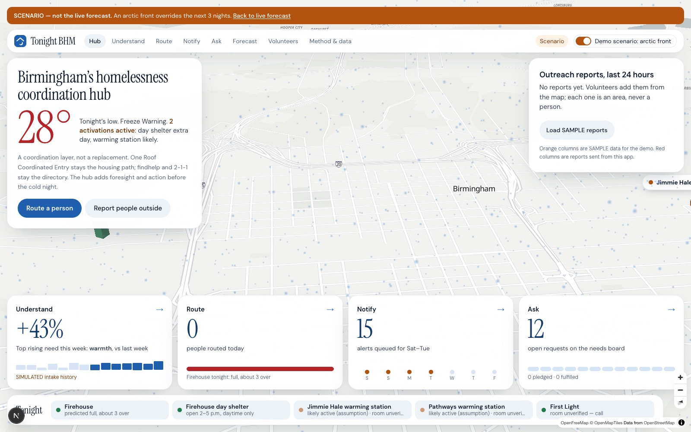
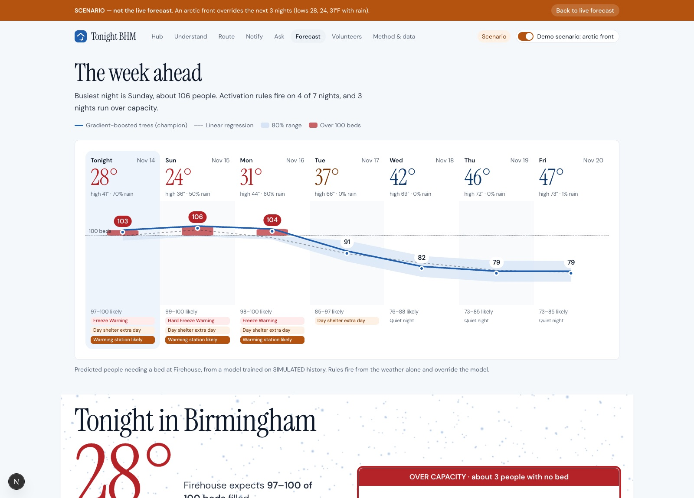
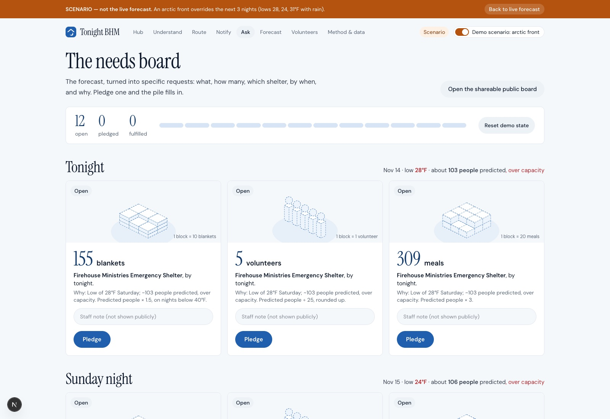
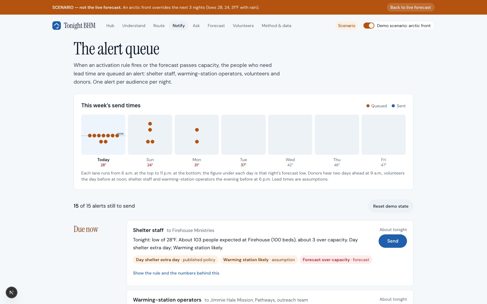
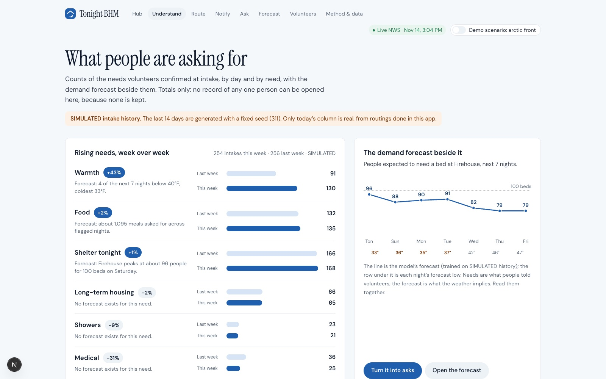
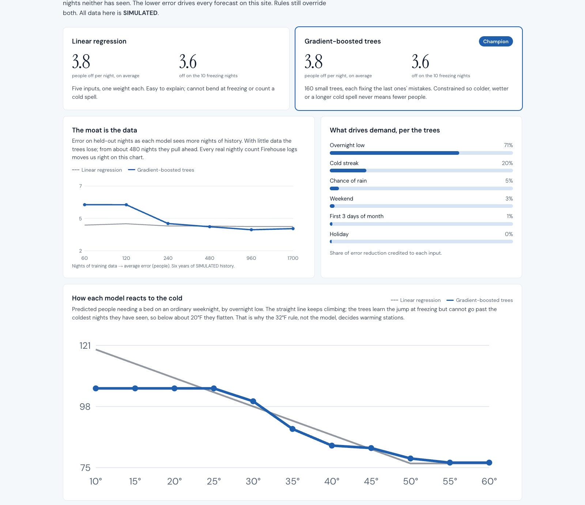

<div align="center">



# Tonight BHM

**We don't wait for the shelter to fill up. We see it coming.**

Birmingham's homelessness coordination hub. It reads the live weather, predicts bed demand with a machine-learning model, fires the rules shelters already use, and turns all of it into routes, alerts and asks before the cold night.


Built at **Shipt Hacks 2026** · *Build a Better Birmingham* · for **Firehouse Ministries**

</div>

---

## The problem

Birmingham opens emergency capacity one cold snap at a time. Firehouse's day shelter opens extra days below 40°F. The city has **two official warming stations**, about **$2,500 a night** each, announced per event. People outside often hear last.

Firehouse provided **29,509** shelter nights and **92,693** meals in 2025. The 2024 point-in-time count found **911** people homeless across Jefferson, Shelby and St. Clair, up from 847.

Tonight BHM is a **coordination layer, not a replacement**. One Roof Coordinated Entry stays the housing path; findhelp and 2-1-1 stay the directory. We add the one thing none of them do: **foresight, and action before the cold night.**

## How it works

<table>
<tr>
<td width="50%" valign="top">

### 1. See the week coming 🌡️
Live forecast from the **National Weather Service**, seven nights out. A **machine-learning model** predicts how many people will need a bed at Firehouse each night, with an 80% range and the 100-bed line. Nights over capacity turn red.

Drag the **cold slider** to ask "what if it drops to 15°F?" and watch the beds, rules and routes recompute live.

</td>
<td width="50%"></td>
</tr>
<tr>
<td width="50%"></td>
<td width="50%" valign="top">

### 2. Turn it into asks 📦
The **needs board** converts the forecast into specific requests: *155 blankets, 5 volunteers and 309 meals for Firehouse by tonight*, each with the reason behind it. Donors pledge, and the stack fills from open to pledged to fulfilled. A shareable public board hides internal notes.

</td>
</tr>
<tr>
<td width="50%" valign="top">

### 3. Tell people early 📣
When a rule fires or the forecast passes capacity, the **alert queue** schedules one alert per audience per night: shelter staff, warming-station operators, volunteers and donors. Each shows the rule and the numbers behind it.

</td>
<td width="50%"></td>
</tr>
<tr>
<td width="50%"></td>
<td width="50%" valign="top">

### 4. Route, and understand 🧭
At the door, a volunteer records a person's needs in three steps, **with no name, date of birth or ID**. Claude suggests need tags from the note; the volunteer confirms them. Plain rules rank where to go tonight and explain every exclusion.

**Insights** show which needs are rising week over week, as totals only, with small groups shown as "<5".

</td>
</tr>
</table>

---

## 🧠 The machine-learning model

Two models compete for every forecast on the site, and **a held-out backtest picks the winner**.

| | Linear regression | Gradient-boosted trees |
|---|---|---|
| What it is | Ordinary least squares, solved with the normal equations | 160 depth-3 regression trees, each fitted to the errors of the ones before |
| Inputs | Cold severity, rain, weekend, holiday, first days of month | The same, plus the raw overnight low and the **cold streak** (nights in a row below 40°F) |
| Strength | Easy to explain, steady with little data | Learns the jump at freezing and the build-up through a cold spell |
| Guardrail | Rules override it | **Monotone constraints:** a colder, wetter or longer cold spell can never mean fewer people. Rules override it too |

Both are **written by hand in TypeScript**, with no ML library ([`lib/model/ols.ts`](lib/model/ols.ts), [`lib/model/gbm.ts`](lib/model/gbm.ts)), so every line can be explained.



**How it is scored.** Every fifth week of history is held out, so the test covers winters and summers alike. The model with the lower mean absolute error becomes the **champion** and drives every number in the app; the other is drawn beside it as a dashed line.

**Why it is a moat.** The learning curve shows the trees **lose with little data and pull ahead after roughly 480 nights**. The algorithm is not the advantage. The nightly data is: every head count a shelter logs makes the forecast better, and nobody else is collecting it.

**What the model is not allowed to do.** It never decides whether a warming station opens. Activation is a published rule (low below 40°F, at or below 32°F), and **rules always override the model**. Trees cannot extrapolate past the coldest nights they have seen, which is exactly why.

> [!IMPORTANT]
> No public nightly shelter counts exist for Birmingham, so the models train on **SIMULATED** history: two years calibrated to Firehouse's real 2025 average of about 81 people a night, including a freezing jump and a cold-streak effect that are our assumptions. The pipeline is real and runs end to end. Plug in Firehouse's real counts and the same code retrains.

---

## Quick start

**You need:** [Node.js 20+](https://nodejs.org).

```bash
npm install
npm run dev
```

**Open [localhost:3000](http://localhost:3000)** 🎉

> [!TIP]
> - **Demo a cold snap:** click **Demo scenario: arctic front** in the header, or add `?scenario=arctic` to any URL. A banner says **SCENARIO — not the live forecast** until you turn it off.
> - **No API key?** Everything works. Intake falls back to keyword matching for need tags.
> - **Offline?** The last forecast is saved to `data/cached_forecast.json` and served with a "cached forecast from…" badge. The 3D map needs internet for its tiles.
> - **Phones in the room:** run `npm run dev -- -H 0.0.0.0` and open `/volunteer` at your laptop's network address.

### Environment variables (all optional)

Copy `.env.example` to `.env.local`.

| Variable | What it does |
| --- | --- |
| `ANTHROPIC_API_KEY` | Turns on Claude for intake notes → need tags |
| `ANTHROPIC_MODEL` | Model for extraction (default `claude-opus-5-5`) |
| `NWS_CONTACT` | Contact email in the NWS `User-Agent` header, which NWS asks every client to send |

## Tests

```bash
npm test               # vitest: rules, both models, routing, asks, alerts, insights
npx tsc --noEmit       # type check
```

## Pages

| Page | What it does |
| --- | --- |
| `/` | **Hub.** 3D map of Birmingham, tonight's status, the four verbs with live numbers, outreach reports by area |
| `/forecast` | **Forecast.** The week ahead, the cold slider, what to line up, and the model arena |
| `/asks` · `/asks/public` | **Ask.** The needs board, and a shareable public version |
| `/notify` | **Notify.** The alert queue across the week |
| `/insights` | **Understand.** Rising needs, with small-cell suppression |
| `/route` | **Route.** Three-step intake and ranked places to go, with reasons |
| `/team` · `/volunteer` | Staff board and the volunteer phone app: shifts, requests, cold-night alert |
| `/about` | Method and data honesty: every formula, what is real and what is simulated |

## What's inside

| Folder | What it does |
| --- | --- |
| [`lib/model/`](lib/model) | Simulated history, hand-written linear regression and gradient-boosted trees, champion selection, planning formulas |
| [`lib/weather/`](lib/weather) | NWS client with caching and fallback; the arctic-front scenario |
| [`lib/rules/`](lib/rules) | Activation rules engine; rules live as data in [`data/activation_rules.json`](data/activation_rules.json) |
| [`lib/routing/`](lib/routing) | Eligibility, open-tonight checks, ranking and plain-language reasons |
| [`lib/asks/`](lib/asks) · [`lib/notify/`](lib/notify) · [`lib/insights/`](lib/insights) | Needs board formulas, alert queue, aggregate needs with suppression |
| [`lib/intake/`](lib/intake) · [`app/api/extract/`](app/api/extract) | Claude turns a note into need tags, validated with Zod |
| [`components/`](components) | 3D city map (MapLibre), particle field and bed floor (three.js), charts, model arena |
| [`data/`](data) | Sites with sources and verification dates; unknowns stored as `null` |

## Principles

- **Predict totals per shelter, never people.** No names, dates of birth or IDs anywhere. Outreach reports are areas rounded to about 300 m and expire after 24 hours.
- **Rules override the model.** A low forecast can never cancel a warming station.
- **AI has one job:** suggesting need tags a person confirms. It never forecasts, routes, writes asks or sends alerts.
- **Honest data.** Anything simulated or assumed is labeled on screen. Unknown capacities show as "unverified — call".

Every choice, with the alternative we rejected, is in [`DECISIONS.md`](DECISIONS.md). What was AI-assisted is in [`AI_LOG.md`](AI_LOG.md).

## Sources

[National Weather Service API](https://api.weather.gov) · [Firehouse emergency shelter](https://firehouseshelter.com/the-emergency-shelter-operation/) · [Firehouse day shelter](https://firehouseshelter.com/?p=14) · [Birmingham Watch: warming stations](https://birminghamwatch.org/2026/01/30/warming-stations-open-as-birmingham-settles-in-for-a-deep-freeze/) · Jadidzadeh & Kneebone (2015), Calgary shelter use and weather · Map data © [OpenStreetMap](https://www.openstreetmap.org/copyright) contributors via [OpenFreeMap](https://openfreemap.org)

## Team

Built by **Gaurav Shrivastava** at Shipt Hacks 2026, Birmingham.
